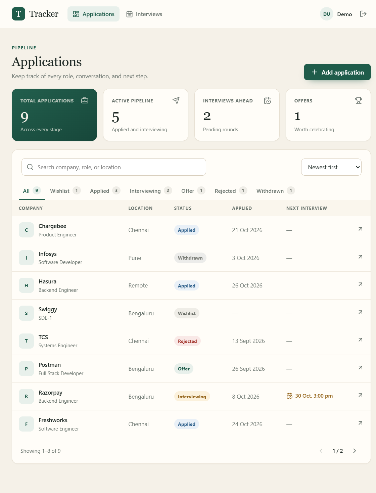
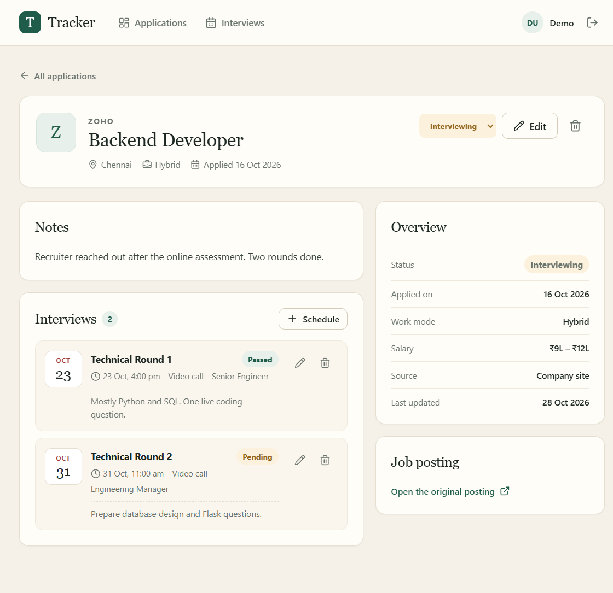
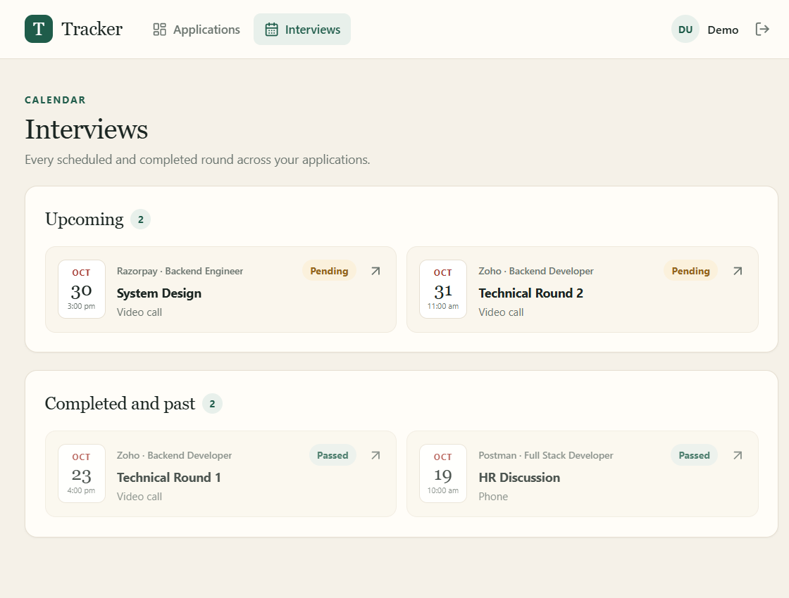

# Job Application Tracker

[](https://github.com/Vardhan32/job-application-tracker/actions/workflows/ci.yml)

A full-stack app for keeping a job search in one place. Applications, interview
rounds, statuses, notes, and follow-ups all live in a single pipeline instead of
being spread across a spreadsheet and a dozen browser tabs.



## Features

- Email/password accounts with JWT authentication; every record is scoped to its owner
- Add, edit, and delete applications with company, role, location, work mode, source, salary range, posting URL, and notes
- Six-stage pipeline: wishlist, applied, interviewing, offer, rejected, withdrawn
- Search across company, role, and location; filter by status; sort by date, application date, or company
- Dashboard totals and per-status counts
- Schedule interview rounds with date, mode, interviewer, outcome, and notes
- Upcoming interview list, plus a separate calendar-style interviews view
- Validated forms on the client and server, with inline field errors
- Pagination for larger pipelines

| Application detail | Interviews |
| --- | --- |
|  |  |

## Stack

| Layer | Tools |
| --- | --- |
| API | Python, Flask, Flask-SQLAlchemy, Flask-JWT-Extended |
| Database | MySQL 8 in production; SQLite fallback for local development and tests |
| Frontend | React 18, Vite, React Router, Axios, plain CSS |
| Tests | pytest, Flask test client |

## Project layout

```text
backend/
  app/
    api/              auth, applications, interviews blueprints
    models.py         User, Application, Interview
    utils.py          validation, JWT user lookup, pagination
    seed.py           demo data
  tests/              15 API tests
  schema.sql          MySQL DDL
  run.py              development entry point
frontend/
  src/
    auth/             session context
    api/              Axios client and interceptors
    components/       layout, modals, forms, shared UI
    pages/            login, register, dashboard, detail, interviews
    utils/            formatting helpers
```

## Running locally

### 1. Database

With MySQL 8 installed:

```bash
mysql -u root -p < backend/schema.sql
```

Create a user for the app (or point `DATABASE_URL` at an existing MySQL user):

```sql
CREATE USER 'tracker'@'localhost' IDENTIFIED BY 'tracker';
GRANT ALL PRIVILEGES ON job_tracker.* TO 'tracker'@'localhost';
FLUSH PRIVILEGES;
```

Copy `backend/.env.example` to `backend/.env` and adjust the credentials.

If you just want to try the app, skip MySQL. The backend falls back to a local
SQLite file (`backend/tracker.db`) when `DATABASE_URL` is not set. The schema and
environment example still target MySQL for deployment.

### 2. API

```bash
cd backend
python -m venv .venv
source .venv/bin/activate        # Windows: .venv\Scripts\activate
pip install -r requirements.txt
flask --app run seed-db
flask --app run run --port 5000
```

`seed-db` creates the tables and loads nine sample applications. The API runs at
`http://localhost:5000`.

### 3. Frontend

```bash
cd frontend
npm install
npm run dev
```

Open `http://localhost:5173`. Vite proxies `/api` to the Flask server.

**Demo account:** `demo@jobtracker.dev` / `demo1234`

## Tests

```bash
cd backend
pytest -q
```

The suite covers registration and login, token protection, CRUD, validation,
search/filter/sort, pagination, stats, interview scheduling, and cross-user
access checks. Tests run against an in-memory SQLite database, so no MySQL
server is needed for CI.

## API reference

All application and interview routes require `Authorization: Bearer <token>`.

| Method | Endpoint | Purpose |
| --- | --- | --- |
| POST | `/api/auth/register` | Create an account and return a token |
| POST | `/api/auth/login` | Sign in |
| GET | `/api/auth/me` | Current user |
| GET | `/api/applications` | List applications (`q`, `status`, `sort`, `page`, `per_page`) |
| POST | `/api/applications` | Create an application |
| GET | `/api/applications/:id` | Application with interview rounds |
| PUT | `/api/applications/:id` | Update an application |
| DELETE | `/api/applications/:id` | Delete an application and its interviews |
| GET | `/api/applications/stats` | Totals, status counts, upcoming interviews |
| GET | `/api/applications/:id/interviews` | Rounds for one application |
| POST | `/api/applications/:id/interviews` | Schedule a round |
| GET | `/api/interviews` | All rounds for the signed-in user |
| PUT | `/api/interviews/:id` | Update a round |
| DELETE | `/api/interviews/:id` | Delete a round |

Validation failures return `422` with a field-level `errors` object. Missing or
invalid tokens return `401`. A user requesting another user's record gets `404`
rather than a permission hint.

## Data model

```text
User 1 ──── * Application 1 ──── * Interview
```

`Application` stores the job details and pipeline status. `Interview` stores the
round, schedule, mode, interviewer, outcome, and notes, and is deleted along with
its application. `schema.sql` includes the matching foreign keys and indexes.

## Implementation notes

- App factory plus blueprints keep configuration, auth, and resources separate.
- Application statuses, work modes, and interview outcomes are validated against
  fixed lists on the server.
- Applications are filtered by the JWT identity at query level, not just on the
  client, so ownership checks apply to reads, writes, and deletes.
- The client stores the token in `localStorage` and attaches it through an Axios
  interceptor. A `401` outside the auth screens clears the session.
- Tests use a separate config class with an in-memory database.

## Possible next steps

- Email or calendar reminders for upcoming interviews
- CSV export for a weekly job-search review
- A drag-and-drop board view as an alternative to the table

## License

MIT
